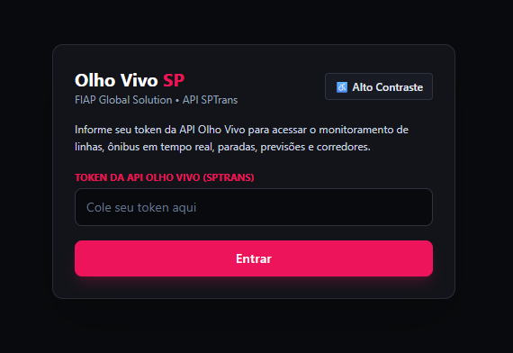

# Olho Vivo SP - Monitoramento de Transporte Público

Aplicação web responsiva desenvolvida para a Global Solution da FIAP, integrada à API Olho Vivo da SPTrans (v2.1). O sistema permite consultar linhas de ônibus, acompanhar a posição em tempo real dos veículos no mapa, localizar pontos de parada, verificar previsões de chegada e listar corredores exclusivos de São Paulo.

## Funcionalidades

- **Autenticação por Token:** Tela inicial para validação do token de acesso da API Olho Vivo da SPTrans com persistência local durante a sessão.
- **Consulta de Linhas e Veículos:** Busca de linhas por número ou nome, visualização das paradas da linha e acompanhamento dos ônibus em tempo real no mapa, com filtro para veículos acessíveis e atualização automática opcional a cada 30 segundos.
- **Paradas e Previsão de Chegada:** Pesquisa de pontos por nome ou endereço e consulta de previsão de chegada por ponto (via mapa, lista ou código direto da parada).
- **Corredores Exclusivos:** Listagem dos corredores de ônibus cadastrados na SPTrans.
- **Interface Responsiva e Acessível:** Layout escuro com painel recolhível em dispositivos móveis e modo de alto contraste (preto, branco e amarelo).

## Tecnologias Utilizadas

- HTML5 e CSS3
- Tailwind CSS (via CDN)
- JavaScript (ES Modules)
- Leaflet.js e OpenStreetMap
- Vercel Rewrites (`vercel.json`) para proxy reverso das requisições à API Olho Vivo

## Como executá-lo

Como o app se encontra em um "Beta fechado", o token criado para o app será disponibilizado apenas para users específicos. <br><br>
Com ele, basta colar na primeira tela do app e todas as funcionalidades serão disponibilizadas: <br><br>

<div align="center">
    
</div>


## Estrutura do Projeto

```text
├── index.html
├── .gitignore
├── vercel.json
├── README.md
├── integrantes.txt
└── assets/
    ├── css/
    │    └─── style.css
    ├── img/
    │    └─── icon.png
    └── js/
        ├── state.js       # Estado global, cliente HTTP e helpers de interface
        ├── map.js         # Configuração do mapa Leaflet e camadas de marcadores
        ├── sptrans.js     # Integração com os endpoints da API Olho Vivo
        ├── ui.js          # Renderização dinâmica dos resultados e previsões
        └── main.js        # Inicialização e gerenciamento de eventos